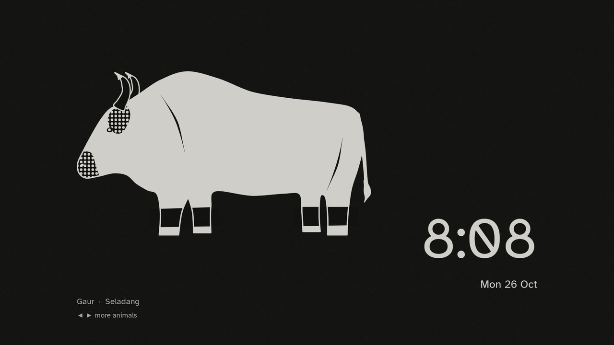

# Add-ons

The e-ink Home keeps the launcher offline and small. Everything that needs the network or other apps' data lives in
a separate app beside it, built from this folder.

| Add-on | What it does | Tested on | Permissions | Screenshot |
|---|---|---|---|---|
| [Today](morning-board/) | Google Calendar and Tasks on the TV (OK ticks a task off), the song Spotify is playing and the last show watched, and the Ink Menagerie screensaver: 50 ink animals that each move in their own way | Chromecast with Google TV HD (boreal), Google TV 14 | network (your own Apps Script), exact alarm, boot, wake lock |  |

Today is its own Gradle project, built and installed beside the launcher; the launcher reads what it shows from
Today through a permission only an app signed with the same key gets, so build both on the same computer. Its
README has the setup, and [docs/google-calendar-tasks.md](../docs/google-calendar-tasks.md) connects your
calendar.

Upstream Clean Your TV has many more add-ons (weather, prayer times, smart home and others) as module cards for its
own launcher; the e-ink Home doesn't show module cards, so they aren't here.
